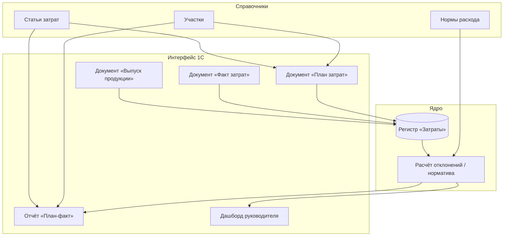

## Context

MVP для финала НТО по профилю «Автоматизация бизнес-процессов». Система управления затратами для одного участка горнодобывающего предприятия (добыча и транспортировка руды). Команда: 2 человека (разработчик + бизнес-аналитик), срок — окно финала. Ограничения: 1С:Предприятие 8.3 (учебная версия), без интеграций с бухгалтерией, датчиками и внешними API. Ввод данных ручной. Контур: план → факт → отклонение → отчёт.

## Goals / Non-Goals

**Goals:**
- Работающий контур ввода плана/факта/выпуска и расчёта отклонений в 1С.
- Отчёт план-факт с подсветкой перерасхода/экономии и итоговой строкой.
- Дашборд руководителя участка (сводка + топ-3 статьи с перерасходом).
- Разграничение ролей: Руководитель участка / Администратор.
- Соответствие NFR-001…NFR-005 из spec.md.

**Non-Goals:**
- Себестоимость всего предприятия, попередельный метод, НЗП.
- Распределение косвенных затрат по нескольким базам.
- Интеграция с 1С:Бухгалтерия, внешними API, датчиками, LLM/AI.
- Автоматический сбор данных (только ручной ввод).

## Decisions

### Компонентная архитектура

Система — монолитное приложение 1С:Предприятие 8.3 (управляемое приложение). Слои:

1. **Справочники (master data):** Участки, Статьи затрат, Нормы расхода.
2. **Документы (транзакционный ввод):** План затрат, Факт затрат, Выпуск продукции.
3. **Регистр накопления «Затраты»:** хранение движений план/факт с аналитикой (участок, статья, тип).
4. **Отчёты (СКД):** План-факт по статьям, Дашборд руководителя.
5. **Роли и права:** Руководитель участка, Администратор.



### Потоки данных

Ключевой поток (ввод факта → отчёт):

```mermaid
sequenceDiagram
    participant U as Руководитель участка
    participant D as Документ «Факт затрат»
    participant R as Регистр «Затраты»
    participant C as Модуль расчёта
    participant O as Отчёт «План-факт»

    U->>D: Открыть, выбрать участок/дату, ввести статью и сумму
    U->>D: Провести
    D->>D: Валидация (сумма > 0, обязательные поля)
    D->>R: Записать движение (тип=Факт)
    U->>O: Выбрать участок и период, «Сформировать»
    O->>R: Запрос плана и факта
    O->>C: Запрос норматива и отклонения
    C-->>O: Норматив = норма × выпуск; отклонение = план − факт
    O-->>U: Таблица с подсветкой перерасхода/экономии
```

### Технологический стек

| Слой | Технология | Обоснование |
|---|---|---|
| Платформа | 1С:Предприятие 8.3 (учебная версия) | Соответствие профилю НТО; доступность; быстрый учётный контур |
| Хранение | Файловая база 1С (учебная) | Достаточно для MVP; резервная копия перед защитой |
| Интерфейс | Управляемое приложение (формы 1С) | Стандартные формы документов и отчётов |
| Отчётность | СКД (система компоновки данных) | Гибкая настройка группировок, колонок, условного оформления |
| Дашборд | Отчёт СКД / внешняя обработка | Быстро, без доп. технологий |
| Роли | Встроенные роли 1С | Разграничение Руководитель/Администратор |

### Модель данных (укрупнённо)

| Объект | Тип | Ключевые реквизиты |
|---|---|---|
| Участки | Справочник | Наименование, Код |
| Статьи затрат | Справочник | Наименование, Тип (топливо/материалы/энергия/труд) |
| Нормы расхода | Справочник | Участок, Статья, Норма на единицу выпуска |
| План затрат | Документ | Участок, Период; ТЧ: Статья, Сумма |
| Факт затрат | Документ | Участок, Дата; ТЧ: Статья, Количество, Сумма |
| Выпуск продукции | Документ | Участок, Период, Ед. изм., Объём |
| Затраты | Регистр накопления | Участок, Статья, Тип (План/Факт), Сумма, Количество |

### Расчётная логика

- **Норматив** = Норма расхода × Фактический выпуск (если норма задана; иначе «н/д»).
- **Отклонение от плана** = План − Факт.
- **% отклонения** = Отклонение / План × 100 (если План ≠ 0; иначе «н/д»).
- Отклонения **не хранятся**, рассчитываются на лету в отчёте/дашборде (проще, меньше риск рассинхронизации).
- **Атомарность:** проведение документа — в транзакции; при ошибке валидации движения не пишутся (NFR-002).

## Risks / Trade-offs

- **Риск:** учебная версия 1С может иметь ограничения по объёму данных → **Митигация:** тестовый набор ≤ 10 000 записей (NFR-001), файловая база.
- **Риск:** команда незнакома с 1С → **Митигация:** бесплатный курс «Лёгкий старт» от УЦ №1 Фирмы 1С; фокус на стандартных механизмах (справочники/документы/регистр/СКД).
- **Риск:** жюри спросит про методику себестоимости → **Митигация:** в защите явно указать: MVP считает только прямые затраты по участку, распределение косвенных — направление развития (Non-Goals).
- **Trade-off:** отказ от хранения отклонений в регистре → меньше нагрузка на запись, но пересчёт при каждом формировании отчёта. Приемлемо при ≤10 000 записей (NFR-001).
- **Trade-off:** ручной ввод вместо интеграций → быстрее сделать, но ниже «реалистичность» с точки зрения предприятия. Компенсируется описанием направлений развития на защите.

## Migration Plan

1. Развернуть учебную 1С, создать пустую файловую базу.
2. Создать справочники (Участки, Статьи затрат, Нормы расхода) и заполнить демо-данными.
3. Создать документы (План, Факт, Выпуск) с валидацией и движениями в регистр.
4. Создать регистр «Затраты» с измерениями/ресурсами.
5. Создать отчёт СКД «План-факт» с условным оформлением.
6. Создать дашборд (отчёт СКД/внешняя обработка).
7. Настроить роли и права.
8. Прогнать демо-сценарий, снять резервную копию.

## Open Questions

- [ ] Точный перечень 4 статей затрат и их коды (топливо/материалы/энергия/труд — подтвердить).
- [ ] Период планирования: смена или месяц (влияет на гранулярность отчёта).
- [ ] База норматива: тонны руды или тонно-километры (влияет на справочник норм).
- [ ] Нужен ли отдельный отчёт «Динамика затрат по периодам» или достаточно план-факт + дашборд.
