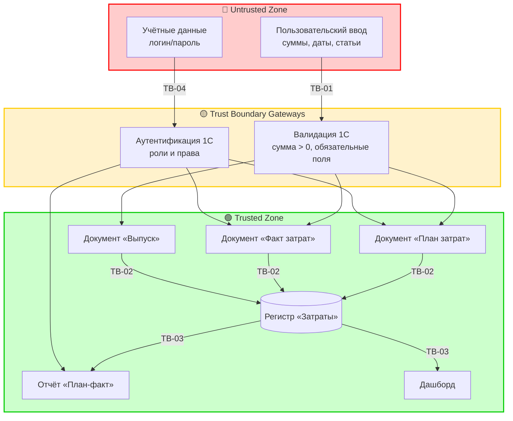

## 1. Выбор методологии

- **Выбрано:** STRIDE (минимальная версия: Trust Boundaries + Top-3 угроз)
- **Обоснование:** `security_context = {"baseline": true}`. Система внутренняя, не работает с ПДн, внешними интеграциями и LLM/AI. Однако присутствуют: аутентификация пользователей (роли), финансовые данные (суммы затрат), ввод с клавиатуры. Для baseline-контекста достаточно минимальной STRIDE-модели, сфокусированной на границах доверия и наиболее значимых угрозах.
- **Отвергнутые альтернативы:**
  - **OWASP Top 10 for LLM** — отклонена: нет LLM/AI-компонентов.
  - **LINDDUN** — отклонена: нет PII, приватность не является ключевым требованием.
  - **PASTA/OCTAVE** — отклонены: избыточны для MVP, нет требования risk-assessment enterprise-уровня.
- **Скоуп:** компоненты ввода данных (документы «План затрат», «Факт затрат», «Выпуск продукции»), регистр «Затраты», отчёт «План-факт», дашборд, роли пользователей. Не покрываются: инфраструктура 1С (ОС, сеть), резервное копирование.

## 2. Активы и классификация данных

| Актив | Класс данных | Компонент | Владелец |
|---|---|---|---|
| Суммы плановых затрат | financial (internal) | Документ «План затрат» → Регистр | Руководитель участка |
| Суммы фактических затрат | financial (internal) | Документ «Факт затрат» → Регистр | Руководитель участка |
| Нормы расхода | internal | Справочник «Нормы расхода» | Администратор |
| Учётные записи пользователей | credentials (internal) | Встроенная аутентификация 1С | Администратор |
| Отчёт план-факт | financial (internal) | Отчёт СКД | Руководитель участка |

## 3. Границы доверия (Trust Boundaries)

| ID | Граница | Откуда → Куда | Контроль безопасности |
|----|---------|---------------|----------------------|
| TB-01 | Пользователь → Документ 1С | интерфейс → валидация 1С | Валидация суммы > 0, обязательные поля |
| TB-02 | Документ → Регистр «Затраты» | документ → регистр | Транзакция проведения (атомарность, NFR-002) |
| TB-03 | Регистр → Отчёт/Дашборд | регистр → СКД | Только чтение, права роли «Руководитель участка» |
| TB-04 | Пользователь → Роль | аутентификация → авторизация | Встроенные роли 1С (Руководитель/Администратор) |

## 4. Визуализация потоков данных (цветовая кодировка)

**Легенда:**
- 🟢 **Trusted** — компоненты под нашим контролем
- 🔴 **Untrusted** — внешние источники ввода (пользовательский ввод)
- 🟡 **Boundary / Gateway** — точки пересечения границ

## 5. Матрица угроз (STRIDE, Top-3 для baseline)

| ID | Категория | Угроза | Вектор | Актив | TB | Уровень | Контроль | Requirement |
|----|-----------|--------|--------|-------|----|--------|----------|-------------|
| TM-01 | T (Tampering) | Искажение суммы факта затрат (случайное или намеренное) | Ручной ввод в документ | Суммы затрат | TB-01 | High | Валидация: сумма > 0; обязательные поля; журнал регистрации 1С | NFR-SEC-001 |
| TM-02 | R (Repudiation) | Отрицание ввода/проведения документа пользователем | Отсутствие доказательств | Финансовые данные | TB-02 | Medium | Журнал регистрации 1С (стандартный): фиксация пользователя, времени, действия | NFR-SEC-002 |
| TM-03 | E (Elevation of Privilege) | Получение роли «Администратор» пользователем с ролью «Руководитель» | Неверная настройка прав 1С | Учётные записи, справочники | TB-04 | Medium | Встроенные роли 1С; минимальные привилегии; аудит прав | NFR-SEC-003 |

> **Примечание:** для baseline-контекста ограничиваемся тремя наиболее значимыми угрозами. Угрозы S (Spoofing) и I (Information Disclosure) оценены как низкие: система локальная, без сетевого доступа; разграничение ролей покрывает базовый контроль доступа. D (DoS) нерелевантна для файловой учебной базы в контексте финала.

## 6. Требования безопасности (→ в spec.md и design.md)

| Requirement | Описание | Покрывает TM | Метрика / verify |
|-------------|----------|--------------|------------------|
| NFR-SEC-001 | Валидация суммы > 0 и обязательных полей при проведении документов «План затрат» и «Факт затрат» | TM-01 | 100% попыток с некорректной суммой блокируются; тест TC-SEC-001 |
| NFR-SEC-002 | Фиксация в журнале регистрации 1С факта проведения документов с указанием пользователя и времени | TM-02 | 100% проведений отражены в журнале; тест TC-SEC-002 |
| NFR-SEC-003 | Разграничение ролей: «Руководитель участка» не имеет прав на изменение справочников и норм; «Администратор» не вводит факт затрат | TM-03 | 0 успешных попыток доступа к чужим функциям; тест TC-SEC-003 |

## 7. Влияние на ADR

> Какие архитектурные решения должны быть приняты/пересмотрены по итогам TM.

- **ADR-кандидат 1:** Использование встроенного журнала регистрации 1С как основного механизма аудита (покрывает NFR-SEC-002, TM-02) vs. разработка собственного журнала.
- **ADR-кандидат 2:** Модель ролей и прав в 1С: две роли (Руководитель/Администратор) с чётким разделением функций (покрывает NFR-SEC-003, TM-03).
- **ADR-кандидат 3:** Стратегия валидации на уровне документов (проверка при записи/проведении) — покрывает NFR-SEC-001, TM-01.
